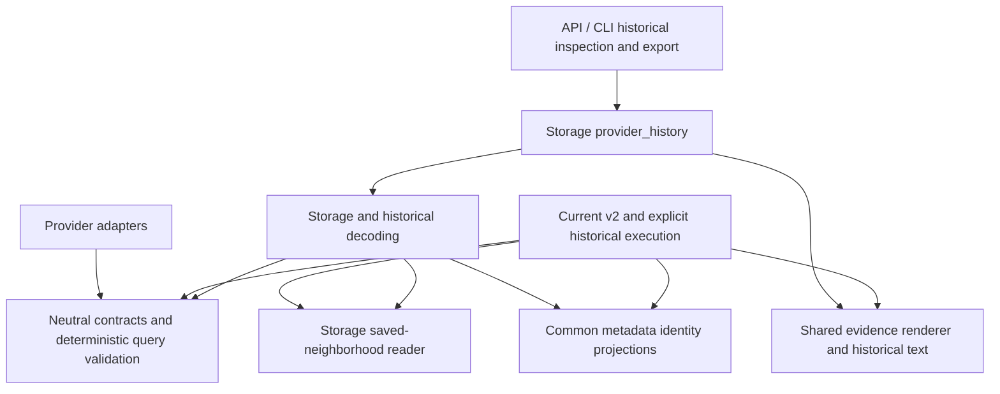

# Prompt 12 — neutral contracts and historical inspection

## Scope and steps

Preserve the existing dirty/staged consolidation and Prompt 10–11 work. Treat the
reviewed provider/storage imports as ownership seams; no startup cycle is claimed.

1. Move stable search, neighborhood, retrieval and extraction data to neutral
   contracts, retaining schemas, validators, frozen fields, enum values and aliases.
2. Migrate actual consumers and remove only retired dependency exceptions.
3. Extract historical inspection/result reconstruction from provider execution.
   Preserve explicit `legacy_runner`, released text/hashes and exact resume checks.
4. Guard the migrated boundaries and verify focused compatibility, full Python,
   lint/format, whitespace and installed resource behavior.

Current v2 still uses evidence renderer/synthesizer. Researcher/Analyst already
re-export neutral evidence helpers. Shared code stays with its current owner.

Original source snapshots, staged binary diff and resource hashes are in
`/private/tmp/researchassistant-prompt12/`. Public schema/enum/config fingerprints
were captured before editing in `tests/fixtures/contract-ownership-before.json`.
The preceding project guidance is preserved in the linked archive.

## Dependency map and remaining exceptions

The graph was refreshed before tracing and again in full mode after source moves
(`ResearchAssistant`: 11,159 nodes / 71,310 edges). Symbol discovery now locates
`SearchResponse` and `ResearcherPairResult` in contracts, `inspect_provider_run` in
storage and `read_neighborhood_checkpoint` in storage. Graph callers are advisory;
live imports, copied bodies and fresh-process calls establish the boundaries.
Git remained on `master` / `94a241b` with the preceding consolidation dirty. No
startup-cycle failure was asserted or repaired.

| Former owner / dependency | Current owner and consumers |
| --- | --- |
| `providers.search` request, results, metadata, telemetry and failure enum | `contracts.search`; provider adapters, research stages, retrieval checkpoints and storage share the same classes. Errors/protocol and transport parameter helpers remain provider-owned. |
| `providers.openalex_neighborhood` response/work/relation/status data | `contracts.neighborhood_results`; adapter, research execution and neighborhood checkpoints use it. |
| Provider ranking/scraper data and historical researcher batches | `contracts.discovery_ranking`, `scraping`, `retrieval`; providers and historical execution use these shapes, while historical decoding no longer imports an agent. |
| `agents.v2_extraction` immutable handoffs | `contracts.extraction`; the current v2 agent retains execution, re-exporting its former classes/policy constants. |
| Historical orchestrator result/enum/accounting data | `contracts.provider_results`; API/CLI, historical decoding, export and explicit legacy execution share it. |
| Research compiler/capability validation | `contracts.query_compiler`, `discovery_capabilities`; old research module paths alias the same modules. Deterministic depth calculation moved too, so compiled request validation loads no research, agent or provider modules. |
| Agent/research stage keys and seed identity projections | `contracts.artifact_keys`, `common.discovery_identity`; execution and storage use one key/projection owner. |
| Historical inspection/reconstruction inside the 4,241-line orchestrator | `storage.provider_history`, supported by `historical_decode` and `evidence.historical_render`; the executable orchestrator is now 3,735 lines and re-exports former reads/results/errors. |
| Mixed neighborhood replay/execution helper | `storage.neighborhood_store.read_neighborhood_checkpoint` authenticates/reparses saved bytes; `research.seed_expansion._checkpoint` selects explicit transport only after a missing checkpoint. Storage cannot dispatch research execution. |
| Cancellation persistence inside historical execution | `storage.run_cancellation`; ordinary API/CLI cancellation retains preflight and cooperative write behavior. |

All six prior restricted imports migrated at actual call sites and their exact
baseline entries were removed. The guard now forbids provider/agent/research imports
in contracts, and agent/research imports in storage, including local, relative and
`TYPE_CHECKING` forms and the old top-level `orchestrator` name. The baseline is `[]`;
the existing stale/count/symbol checks remain. No global ban on all backend imports
was introduced.

Two deliberate storage-provider seams remain: `discovery_store` uses
`providers.ranking.canonical_discovery_url`, and `neighborhood_store` uses the pure
`OpenAlexNeighborhoodAdapter.parse_resolution/parse_expansion` methods to authenticate
saved HTTP bytes. Those methods create no adapter/client, send no request and perform
no reservation. Storage-to-provider imports remain permitted by the guard. Further
parser/URL ownership extraction can be reviewed separately without weakening exact
replay/provenance checks.

The installed `orchestrator` compatibility module still explicitly aliases the
historical executable module. The CLI's `__getattr__` lazily resolves its former
`run_mvp3b_pipeline` symbol only when requested. `legacy_runner` and the controller's
older `runner` alias retain execution behavior. Ordinary API/CLI also retain current
v2 execution/result/progress dependencies for their existing product behavior.
Researcher/Analyst remain evidence facades; current v2 uses evidence renderer and
synthesizer. No shared helper was moved into a legacy-only folder.

## Compatibility evidence

- The immutable pre-change fixture contains **36** JSON-schema/configuration or enum
  fingerprints, including nested page/neighborhood checkpoints. All match after the
  move. Installed historical namespaces and canonical imports expose identical class
  objects, retaining Pydantic validation/frozen behavior and exact Decimal JSON.
- **32** moved class/function bodies match their original AST; the request validator's
  compiler import is the intentional owner change. Historical read helpers, accounting,
  combining recognized historical rounds and metadata identity logic otherwise retain
  their original bodies.
- Existing synthetic August/legacy/prior-v2 fixtures retain their released text/hashes,
  explicit recorded policy meanings, strict-current rejection, per-record corruption
  results, snapshot ownership and byte/mtime nonmutation. Fresh subprocesses block
  both historical orchestrator import names through inspection, history/trail, evidence
  browsing, controller/CLI inspection and Markdown export.
- All **18** prompt resources and **3** font/license/README resources retain their
  pre-task SHA-256 values. Historical fixtures were not rewritten. No real history,
  released artifact or saved fingerprint was modified.
- Source identity changes from
  `source-sha256:a524568b2932d8ab6e5058adfd6196899e4f7d7a71cd586549d7b84d8ccafc6d`
  to `source-sha256:3768f41771f0fe210ceda310b7867b7963df52c9c8ec1a549b5aec63dc2a577f`.
  Existing exact-resume tests reject incompatible identity and preserve historical
  inspection, terminal results and conservative accounting. No identity conversion
  or resume fallback was added.

## Verification

The work began October 10 and was checked October 11, 2026 on macOS arm64 with the
installed Python 3.12.14 development environment, fake providers and isolated data.

| Step | Focused result |
| --- | --- |
| Neutral data contracts | **139 passed**: schemas/aliases, query pages, neighborhoods, history/export and original guard. |
| Actual call-site/replay migration | **185 passed**: compiler/depth/retrieval, seed identity/replay/shared limits, history/export and schemas. |
| Historical inspection extraction | **202 passed**: pipeline selection, historical reads, read-only inspection, incompatible resume, Markdown/PDF exports and historical orchestration behavior. |
| Ratcheted guard and fresh-process calls | **139 passed**: ownership/serialization, blocked historical execution, history/export/resume, resources and type/import boundaries. |

`verify_distribution.py` passes with the existing offline wheelhouse and current
constraints: exact **266-file** wheel bytes, fresh wheel/editable installs from unrelated
directories, preserved 18 prompts/font, equal source identity, credential-free API
construction, released/blocked fixtures, three-page PDF and fresh/replayed bindings.
The wheel inventory and logs remain under `/private/tmp/researchassistant-prompt12/`.

Full Python: **2,439 passed, 5 existing skips** (**2,444 collected**, 296.27 seconds).
Ruff lint/format (**421 Python files**), layout/dependency guard and staged/unstaged
whitespace pass. The original staged binary diff remains byte-identical; no staging,
commit or branch switch occurred. [STATUS](../project/STATUS.md) owns current state.
Native installers/window/platform delivery and paid quality calls are outside this
ownership task; the installed app and public release remain the preceding artifacts.
